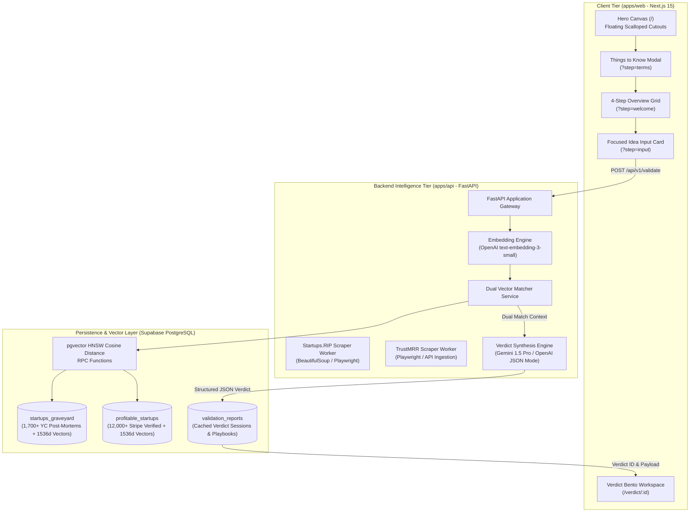
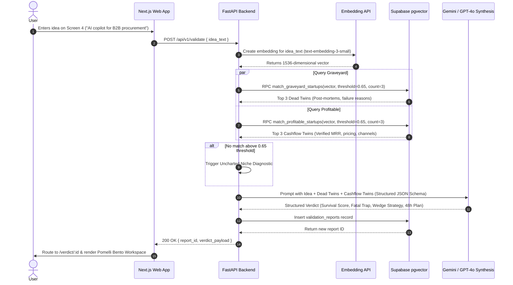

# Architecture Specification — verelli.lol

---

## 1. System Overview & Architectural Topology

verelli.lol operates as a modern decoupled monorepo comprised of an ultra-responsive Next.js 15 frontend web application, an asynchronous FastAPI ingestion and vector intelligence backend, and a PostgreSQL database extended with `pgvector` hosted on Supabase.



---

## 2. Technology Stack Selection & Rationale

| Layer | Technology | Version | Architectural Rationale |
| :--- | :--- | :--- | :--- |
| **Frontend Framework** | **Next.js (App Router)** | `15.x` | Server Components for instant TTFB, client transitions for query-param modal states (`?step=...`), zero hydration mismatch. |
| **Language (Web)** | **TypeScript** | `5.5+` | Strict mode enforced, end-to-end typed API response schemas matching backend Pydantic models. |
| **Styling Engine** | **Tailwind CSS** | `3.4+` | Custom token design system mirroring Pomelli (`#191E0B`, `#B8C468`, `#11120E`, `#242620`). |
| **Motion & Physics** | **Framer Motion** | `11.x` | Spring physics for floating organic hero cutouts (`-12°` to `+15°` tilt), step transitions, and radial glow ambiance. |
| **Icons & Typography** | **Lucide React + IvyPresto / Instrument Serif** | Latest | Minimalist line icons (flask, skull, check-badge, arrow-right) + luxury botanical italic serif typography. |
| **Backend Framework** | **FastAPI (Python)** | `0.115+` | High-throughput asynchronous async/await endpoints, native Pydantic v2 validation, native AI SDK integration. |
| **Ingestion Pipeline** | **Playwright + BeautifulSoup4** | Latest | Handles dynamic JavaScript rendering on TrustMRR and deep HTML parsing on Startups.RIP post-mortems. |
| **Vector Embeddings** | **OpenAI `text-embedding-3-small`** | `1536 dims` | High semantic accuracy for business models, low latency (<80ms per embedding), cost-effective embedding generation. |
| **Vector DB** | **Supabase PostgreSQL + `pgvector`** | `0.7+` | HNSW indexing for sub-15ms cosine similarity searches across 15,000+ combined vector records. |
| **LLM Synthesis Layer**| **Gemini 1.5 Pro / OpenAI GPT-4o** | Structured Output | Synthesizes complex graveyard post-mortems and Stripe MRR data into an objective Survival Score & 48h Playbook without hallucinating figures. |

---

## 3. Monorepo Directory & File Organization

The project is structured as an isolated, clean monorepo ensuring complete separation between the Next.js presentation layer and the Python data pipeline:

```
/Users/apple/Desktop/verelli.lol/
├── apps/
│   ├── web/                               # Next.js 15 Frontend
│   │   ├── app/
│   │   │   ├── layout.tsx                 # Root layout with IvyPresto / Plus Jakarta fonts
│   │   │   ├── page.tsx                   # Orchestrator for Hero, Modals & Step States
│   │   │   ├── verdict/
│   │   │   │   └── [id]/
│   │   │   │       └── page.tsx           # Verdict Bento Workspace Page
│   │   │   └── api/                       # Optional Next.js Edge proxy routes
│   │   ├── components/
│   │   │   ├── hero/
│   │   │   │   ├── HeroCanvas.tsx         # Centerpiece title, subtitle, CTA pill
│   │   │   │   ├── FloatingCard.tsx       # Framer Motion floating container
│   │   │   │   ├── TiltedPillTag.tsx      # Tilted tag pill (-12° to +15°)
│   │   │   │   ├── TypographyCard.tsx     # Aa Ivypresto $24.5K MRR preview card
│   │   │   │   ├── SwatchPaletteCard.tsx  # 3-chip color swatch (#34534d, #80979a, #d3b79c)
│   │   │   │   └── ScallopedCutout.tsx    # Organic botanical SVG scalloped cutout
│   │   │   ├── modals/
│   │   │   │   ├── ThingsToKnowModal.tsx  # Step 2 compliance modal with olive links
│   │   │   │   └── StayConnectedModal.tsx # Step 3A newsletter/updates checkbox popup
│   │   │   ├── onboarding/
│   │   │   │   ├── OnboardingGrid.tsx     # Step 3B 4-column numbered overview grid
│   │   │   │   ├── StepCard.tsx           # Numbered card with bottom radial glow container
│   │   │   │   └── IdeaInputCard.tsx      # Step 4 focused input card with dual wide buttons
│   │   │   ├── verdict/
│   │   │   │   ├── VerdictBento.tsx       # 4-card Pomelli verdict layout
│   │   │   │   ├── SurvivalGauge.tsx      # SVG animated circular score gauge (0-100%)
│   │   │   │   ├── DeadTwinCard.tsx       # Startups.RIP post-mortem card
│   │   │   │   ├── CashflowTwinCard.tsx   # TrustMRR live Stripe card
│   │   │   │   └── PlaybookCard.tsx       # 48-hour validation playbook & export
│   │   │   └── shared/
│   │   │       ├── RadialGlow.tsx         # Reusable ambient olive-sage glow
│   │   │       └── PillButton.tsx         # Standard Pomelli-styled button variants
│   │   ├── hooks/
│   │   │   ├── useStepNavigation.ts       # Query-param state management (?step=...)
│   │   │   └── useValidationStream.ts     # SSE stream / polling for verdict progress
│   │   ├── styles/
│   │   │   └── globals.css                # Custom CSS variables, fonts, KaTeX styling
│   │   ├── tailwind.config.ts             # Pomelli color tokens, fonts, animations
│   │   ├── package.json
│   │   └── tsconfig.json
│   │
│   └── api/                               # FastAPI Data Pipeline & Intelligence Server
│       ├── app/
│       │   ├── main.py                    # FastAPI entrypoint and CORS middleware
│       │   ├── core/
│       │   │   ├── config.py              # Pydantic Settings (Supabase, OpenAI, Gemini)
│       │   │   └── database.py            # Supabase Async Engine & Connection Pool
│       │   ├── scrapers/
│       │   │   ├── startups_rip.py        # Scrapes 1,700+ YC post-mortems from Startups.RIP
│       │   │   └── trustmrr.py            # Ingests 12,000+ verified Stripe MRR profiles
│       │   ├── services/
│       │   │   ├── embedding_service.py   # OpenAI text-embedding-3-small vectorizer
│       │   │   ├── vector_matcher.py      # Dual pgvector semantic cosine query runner
│       │   │   └── synthesis_service.py   # LLM structured JSON output synthesis
│       │   ├── models/
│       │   │   ├── schemas.py             # Pydantic request/response payload contracts
│       │   │   └── entities.py            # Database entity definitions
│       │   └── api/v1/
│       │       ├── endpoints/
│       │       │   ├── validate.py        # POST /api/v1/validate & GET /api/v1/verdict/{id}
│       │       │   └── scrape.py          # Admin endpoints for pipeline triggers
│       │       └── router.py
│       ├── requirements.txt               # fastapi, uvicorn, pydantic, supabase, openai, etc.
│       └── Dockerfile
│
├── docs/                                  # Project Documentation & Architecture
│   ├── PRD.md
│   ├── Architecture.md
│   ├── rules.md
│   ├── phases.md
│   ├── design.md
│   └── memory.md
│
├── package.json                           # Root workspace definition
└── README.md
```

---

## 4. Database Schema & Vector Search Design (`pgvector`)

### 4.1 Table Definitions (`PostgreSQL 16` via Supabase)

```sql
-- Enable vector extension
CREATE EXTENSION IF NOT EXISTS vector;

-- Table 1: Startups.RIP Graveyard Database
CREATE TABLE IF NOT EXISTS startups_graveyard (
    id UUID PRIMARY KEY DEFAULT gen_random_uuid(),
    name VARCHAR(255) NOT NULL,
    slug VARCHAR(255) UNIQUE NOT NULL,
    yc_batch VARCHAR(32),                     -- e.g. "W18", "S21", or NULL
    founded_year INT,
    died_year INT,
    capital_raised_usd NUMERIC(15, 2),
    primary_category VARCHAR(128),
    pitch_summary TEXT NOT NULL,
    post_mortem_text TEXT NOT NULL,
    failure_reasons JSONB NOT NULL,            -- e.g. ["high_cac", "bad_timing", "co-founder_strife"]
    source_url TEXT,
    embedding vector(1536),                   -- Generated via text-embedding-3-small
    created_at TIMESTAMPTZ DEFAULT NOW()
);

-- Table 2: TrustMRR Profitable SaaS Database
CREATE TABLE IF NOT EXISTS profitable_startups (
    id UUID PRIMARY KEY DEFAULT gen_random_uuid(),
    name VARCHAR(255) NOT NULL,
    slug VARCHAR(255) UNIQUE NOT NULL,
    stripe_verified_mrr NUMERIC(12, 2) NOT NULL,
    active_subscribers INT,
    arpu NUMERIC(10, 2),
    pricing_model VARCHAR(64),                 -- e.g. "seat_based", "usage_based", "flat_rate"
    niche VARCHAR(128) NOT NULL,
    pitch_summary TEXT NOT NULL,
    acquisition_channels JSONB,                -- e.g. ["seo", "cold_email", "programmatic_pages"]
    verified_at TIMESTAMPTZ NOT NULL,
    live_url TEXT,
    embedding vector(1536),                   -- Generated via text-embedding-3-small
    created_at TIMESTAMPTZ DEFAULT NOW()
);

-- Table 3: User Validation Reports
CREATE TABLE IF NOT EXISTS validation_reports (
    id UUID PRIMARY KEY DEFAULT gen_random_uuid(),
    idea_text TEXT NOT NULL,
    source_url TEXT,
    survival_score INT NOT NULL,               -- Calibrated 0 - 100
    risk_level VARCHAR(32) NOT NULL,           -- "critical", "contested", "high_potential"
    graveyard_twins JSONB NOT NULL,            -- Top 3 Startups.RIP matches with similarity scores
    cashflow_twins JSONB NOT NULL,             -- Top 3 TrustMRR matches with similarity scores
    synthesis_report JSONB NOT NULL,           -- Structured synthesis: 48h playbook, wedge angle
    query_embedding vector(1536),
    created_at TIMESTAMPTZ DEFAULT NOW()
);

-- HNSW Vector Indexes for Sub-15ms Similarity Lookups
CREATE INDEX IF NOT EXISTS idx_graveyard_embedding 
ON startups_graveyard USING hnsw (embedding vector_cosine_ops) 
WITH (m = 16, ef_construction = 64);

CREATE INDEX IF NOT EXISTS idx_profitable_embedding 
ON profitable_startups USING hnsw (embedding vector_cosine_ops) 
WITH (m = 16, ef_construction = 64);
```

### 4.2 Supabase Vector RPC Functions

```sql
-- Search Top Dead Twins
CREATE OR REPLACE FUNCTION match_graveyard_startups (
  query_embedding vector(1536),
  match_threshold float,
  match_count int
)
RETURNS TABLE (
  id UUID,
  name VARCHAR,
  slug VARCHAR,
  yc_batch VARCHAR,
  died_year INT,
  capital_raised_usd NUMERIC,
  pitch_summary TEXT,
  post_mortem_text TEXT,
  failure_reasons JSONB,
  similarity float
)
LANGUAGE plpgsql
AS $$
BEGIN
  RETURN QUERY
  SELECT
    sg.id,
    sg.name,
    sg.slug,
    sg.yc_batch,
    sg.died_year,
    sg.capital_raised_usd,
    sg.pitch_summary,
    sg.post_mortem_text,
    sg.failure_reasons,
    1 - (sg.embedding <=> query_embedding) AS similarity
  FROM startups_graveyard sg
  WHERE 1 - (sg.embedding <=> query_embedding) > match_threshold
  ORDER BY sg.embedding <=> query_embedding
  LIMIT match_count;
END;
$$;

-- Search Top Profitable Cashflow Twins
CREATE OR REPLACE FUNCTION match_profitable_startups (
  query_embedding vector(1536),
  match_threshold float,
  match_count int
)
RETURNS TABLE (
  id UUID,
  name VARCHAR,
  slug VARCHAR,
  stripe_verified_mrr NUMERIC,
  active_subscribers INT,
  arpu NUMERIC,
  pricing_model VARCHAR,
  niche VARCHAR,
  pitch_summary TEXT,
  acquisition_channels JSONB,
  similarity float
)
LANGUAGE plpgsql
AS $$
BEGIN
  RETURN QUERY
  SELECT
    ps.id,
    ps.name,
    ps.slug,
    ps.stripe_verified_mrr,
    ps.active_subscribers,
    ps.arpu,
    ps.pricing_model,
    ps.niche,
    ps.pitch_summary,
    ps.acquisition_channels,
    1 - (ps.embedding <=> query_embedding) AS similarity
  FROM profitable_startups ps
  WHERE 1 - (ps.embedding <=> query_embedding) > match_threshold
  ORDER BY ps.embedding <=> query_embedding
  LIMIT match_count;
END;
$$;
```

---

## 5. End-to-End Validation Engine Sequence



---

## 6. Synthesis Prompt Contract & JSON Schema

The FastAPI synthesis service enforces strict typing using Pydantic schemas:

```python
from pydantic import BaseModel, Field
from typing import List, Optional

class DeadTwinSummary(BaseModel):
    name: str
    yc_batch: Optional[str]
    died_year: int
    capital_burned: float
    fatal_flaw: str = Field(description="The exact post-mortem reason why they failed")
    post_mortem_quote: str
    similarity_score: float

class CashflowTwinSummary(BaseModel):
    name: str
    verified_mrr: float
    subscribers_count: int
    pricing_tier: str
    primary_acquisition_channel: str
    similarity_score: float

class ActionablePlaybookStep(BaseModel):
    timeframe: str = Field(description="e.g. Hour 0-12, Hour 12-24, Hour 24-48")
    title: str
    description: str
    tactical_deliverable: str

class VerdictReportSchema(BaseModel):
    survival_score: int = Field(ge=0, le=100, description="Calibrated survival score 0-100")
    risk_level: str = Field(description="'Critical Risk', 'Contested Waters', or 'High-Potential Wedge'")
    executive_verdict: str = Field(description="Uncompromising 2-sentence brutal truth")
    top_dead_twins: List[DeadTwinSummary]
    top_cashflow_twins: List[CashflowTwinSummary]
    deadly_pitfalls_to_avoid: List[str]
    wedge_differentiation_angle: str
    validation_playbook_48h: List[ActionablePlaybookStep]
```

