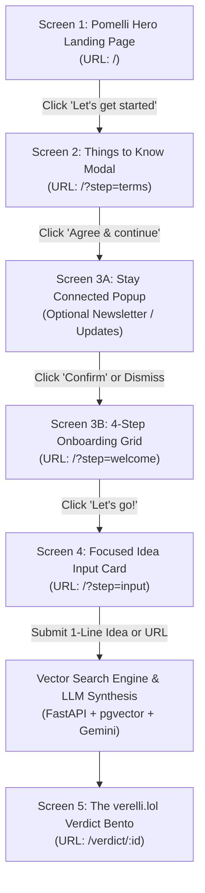

# Project Requirements Document (PRD) — verelli.lol

---

## 1. Executive Summary & Vision

**Product Name:** verelli.lol  
**Tagline:** *Validate your startup idea with graveyard post-mortems and verified MRR*  
**Product Category:** AI Pre-Build Startup Idea Validator & Quantitative Feasibility Engine  
**Target URL:** `verelli.lol`  

### 1.1 The Core Problem
Founders, indie hackers, and solo developers routinely suffer from **"False Positive Validation"**:
1. Asking LLMs (like default ChatGPT or Claude) for idea validation yields sycophantic praise ("That's an innovative idea! Here are 10 marketing channels...").
2. Founders spend 3 to 6 months building an MVP in isolation, only to discover fatal distribution traps, zero willingness-to-pay, or impossible customer acquisition costs (CAC).
3. Post-mortems are scattered across Hacker News, defunct blogs, and YC Graveyard archives, inaccessible during ideation.
4. Meanwhile, profitable micro-SaaS data is opaque, leading founders to guess pricing models and total addressable niche sizes.

### 1.2 The verelli.lol Solution
**verelli.lol** is a zero-fluff startup validation engine. Instead of generic AI platitudes, verelli.lol cross-references any startup idea against two authoritative, real-world datasets:
- **`Startups.RIP` Dataset:** 1,700+ deceased Y Combinator and venture-backed startups with detailed post-mortems and post-mortem failure taxonomy (e.g., CAC > LTV, premature scaling, regulatory death, zero retention, bad timing).
- **`TrustMRR` Dataset:** 12,000+ Stripe-verified profitable micro-SaaS startups with real-time live MRR, ARPU (Average Revenue Per User), pricing tiers, web traffic, and growth velocity.

Within **48 hours before writing a single line of code**, verelli.lol delivers a data-backed verdict:
- **Dead Twins:** Who attempted this exact premise before, how much capital they burned, and why they shut down.
- **Cashflow Twins:** Who is successfully monetizing this exact market right now, what they charge, and how they acquired customers.
- **verelli.lol Survival Score (0–100%):** A calibrated probabilistic score based on historical graveyard similarity vs. live market revenue density.
- **48-Hour Validation Playbook:** A counter-intuitive wedge strategy and zero-code fake-door validation experiment plan.

---

## 2. Target Audience & Personas

| Persona | Core Profile | Pain Point | verelli.lol Value Proposition |
| :--- | :--- | :--- | :--- |
| **The Solo Indie Hacker** | Technical builder, writes code fast, struggles with customer discovery. | "I spent 4 months building a SaaS tool that nobody wants to pay for." | Instant graveyard check; proves if willingness-to-pay exists via Stripe-verified peers. |
| **The Serial Micro-SaaS Founder** | Evaluates 5–10 ideas a month, buys domain names impulsively. | Needs rapid filtering to kill bad ideas before allocating weekend sprints. | 60-second semantic analysis scoring viability and identifying failure traps. |
| **Product Studio / Agency Founder** | Builds internal ventures or validates client startup concepts. | Client validation requires days of manual desk research and competitor spreadsheets. | Automated, professional Validation Book exportable for stakeholders. |

---

## 3. Visual Identity & Pomelli (Google Labs) 1:1 Experience Pattern

verelli.lol adopts the exact dark botanical aesthetic, bespoke typography, organic scalloped cutouts, and tactile floating micro-surfaces introduced by **Pomelli (Google Labs)**.

### Visual Pillars:
- **Deep Olive-Black Canvases:** `#191E0B` (Hero canvas) and `#11120E` (Obsidian canvas for onboarding & workspace).
- **Pistachio Lime Accents:** `#B8C468` (Primary CTAs), `#363E1D` (Moss secondary pill buttons), and `#C5D37A` (Lime text highlights).
- **IvyPresto Headline / Italic Serif:** Elegant, editorial, bespoke italic serif typography (`400 Regular Italic`) contrasted against ultra-clean sans-serif UI copy (`Google Sans` / `Plus Jakarta Sans`).
- **Tactile Floating Objects:** Organic scalloped cutouts, circular graphic previews, color swatch cards, and tilted pill tags (`-12°` to `+15°`) with spring physics and gentle float animations (`y: [-6, 6]`).

---

## 4. Comprehensive User Flow & Screen Specifications

### Screen 1: Pomelli Hero Landing Page (`/`)
* **Background Surface:** Deep Botanical Olive (`#191E0B`).
* **Hero Content:**
  * Centered large italic serif display title: *"verelli.lol"* (`IvyPresto Headline` / `Instrument Serif`, `88px`, letter-spacing `-0.02em`, color `#EDEFE6`).
  * Concise editorial subtitle: *"Validate your startup idea with graveyard post-mortems and verified MRR"*.
  * Primary Pill CTA: `"Let's get started"` in Pistachio Lime (`#B8C468`) with dark botanical olive text (`#14180A`), rounded full (`9999px`), subtle lime aura glow on hover (`#C6D276`).
* **Surrounding Floating Organic Elements (1:1 Pomelli Pattern):**
  * **Top-Left Graphic:** Scalloped circular botanical mask showing dynamic risk gradient (`#34534d` Forest Teal to `#80979a` Sage Slate) with soft float animation.
  * **Top-Right Typography Card:** Dark matte card (`#242620`, border `1px solid #2E3029`) tilted at `+8°` showing:
    * *"Aa Ivypresto Headline"* in italic serif.
    * Subtext: `"$24.5K Verified MRR · TrustMRR Live Feed"`.
  * **Left Tilted Tag Pills:** Floating pill tags tilted at `-12°` and `-6°`:
    * Pill 1: `[● Stripe Verified]` (`#1B200E` background, lime dot, border `1px solid #363E1D`).
    * Pill 2: `[☠ Graveyard Checked]` (`#23251F` background, text `#9A9D93`).
  * **Right Tilted Tag Pills & Swatch Cards:**
    * Color Swatches Card: 3 vertical/horizontal chips showing `#34534d`, `#80979a`, `#d3b79c`.
    * Pill 3: `[⚡ Low CAC Wedge]` tilted at `+14°`.
    * Pill 4: `[✦ High Retention SaaS]` tilted at `-4°`.
* **Below Fold Section:**
  * Smooth scroll reveals an ambient glowing frame with:
    * Label: `"Introducing verelli.lol | Product Experiment"`.
    * Interactive video player card / animated walkthrough in 16:9 aspect ratio with olive inner border glow (`rgba(163, 184, 99, 0.22)`).
  * Minimalist footer with Google Labs-style disclaimer, links to dataset origins, and copyright.

---

### Screen 2: "Things to Know" Compliance Modal (`/?step=terms`)
* **Backdrop:** Ultra-Dark semi-translucent obsidian (`#121210 / 80% backdrop-blur-md`).
* **Modal Surface:** Matte Charcoal Olive (`#252622`), border `1px solid #3A3D34`, border-radius `24px`, padding `32px`.
* **Header:** Italic serif heading *"Things to know before we begin"*.
* **Content Items (with Olive-Underlined Links):**
  1. **Data Provenance:** Explains how data is ingested from [Startups.RIP](https://startups.rip) post-mortems (1,700+ YC/AngelList records) and [TrustMRR](https://trustmrr.com) Stripe-verified platform metrics.
  2. **Probabilistic Matching:** Vectors compute cosine distance across problem statements, target personas, and monetization models. It is a feasibility engine, not legal/financial investment advice.
  3. **Privacy & Idea Security:** Raw submitted ideas are embedded in memory and not trained into public LLM weights without consent.
* **Footer Actions:**
  * Left: `"Exit"` text button (color `#9A9D93`, hover `#EDEFE6`) navigating back to landing.
  * Right: `"Agree & continue"` dark olive pill button (`#1B200E`, text `#C5D37A`, border `1px solid #363E1D`, hover background `#283015`).

---

### Screen 3: "Welcome to verelli.lol" 4-Step Onboarding Grid + "Stay Connected" Modal (`/?step=welcome`)
* **Pre-Step Modal ("Stay Connected"):**
  * Minimalist overlay: *"Stay updated on newly deceased startups & MRR breakouts"*.
  * Lime-accented checkboxes:
    * `[✓] Weekly Graveyard Post-Mortem Deconstructs`
    * `[✓] Verified Micro-SaaS Niche Revenue Alerts`
  * Action: `"Confirm"` pill button (`#B8C468`) or text button `"Skip for now"`.
* **Main Onboarding View:**
  * Top Badge: Small lime flask icon with pill label `[✦ Product Experiment]`.
  * Heading: Editorial italic serif *"Welcome to verelli.lol"* (`48px`, color `#EDEFE6`).
  * Subtitle: *"Validate your startup idea with hard data before writing a single line of code"*.
  * **4-Column Horizontal Numbered Cards Grid:**
    Each card features:
    - Dimensions: `280px` min-width, `420px` height, `24px` border-radius.
    - Surface: Matte Charcoal (`#181916`), border `1px solid #2E3029`.
    - Top Meta: Large sans-serif step number (`1`, `2`, `3`, `4`) in `#80979a` (`28px`, bold).
    - Content: Bold title + 2-line concise description (`#9A9D93`).
    - Bottom Half: Rounded inset preview container (`#11120E`, border `1px solid #23251F`) with a soft olive radial glow (`radial-gradient(circle, rgba(163, 184, 99, 0.22) 0%, rgba(17, 18, 14, 0) 70%)`) displaying dynamic miniature UI mockups:
      * **Card 1: Build your Idea Profile** — Enter 1-line startup idea or landing page URL. Miniature preview shows an input field with typing animation `“AI copilot for B2B procurement...”`.
      * **Card 2: Scan the Startup Graveyard** — Match against 1,700+ dead YC startups. Miniature preview shows graveyard skull tag, red badge `“Died 2023 · CAC exceeded LTV by 4.2x”`, and post-mortem snippet.
      * **Card 3: Verify Live Niche MRR** — Match against 12,000+ Stripe-verified startups. Miniature preview shows green badge `“$31.2K MRR · 410 Active Subscribers · $89 ARPU”`.
      * **Card 4: Create your Validation Book & 48h Plan** — Generate Survival Score, wedge positioning, and zero-code fake-door experiment. Miniature preview shows score gauge `78%` with action checklist.
  * **Bottom Center Action:**
    * Pistachio-lime pill button `"Let's go!"` (`#B5C269`, text `#14180A`, `padding: 14px 44px`, font-size `16px`, font-weight `500`).

---

### Screen 4: Focused Idea Input Card (`/?step=input`)
* **Canvas Backdrop:** Ultra-Dark Obsidian Olive (`#11120E`).
* **Centerpiece:** Centered dark rounded card (`#23251F`, `1px` border `#44473E`, border-radius `24px`, max-width `680px`, padding `40px`) suspended over a warm radial olive-sage ambient glow.
* **Card Heading:** Italic serif *"Enter your startup idea"* (`36px`, color `#EDEFE6`).
* **Card Subtitle:** *"We'll analyze your concept against 1,700+ dead startups and 12,000+ profitable SaaS businesses"*.
* **Input Field:**
  * Full-width dark input surface (`#161713`, border `1px solid #363E1D`, focus-ring `1px solid #B8C468`, border-radius `14px`, padding `16px 20px`, text `#EDEFE6`, placeholder `#686B60`).
  * Placeholder: *"e.g. An AI-powered agent that monitors Stripe chargebacks and disputes evidence automatically"* or *"https://mylandingpage.com"*.
* **Bottom Dual Wide Pill Buttons:**
  * Left Button: Muted moss button `"No website yet? Type raw idea"` (`#363E1D`, text `#C5D37A`, hover background `#454F26`, border `1px solid #4F5A2C`).
  * Right Button: Charcoal button `"Continue"` (`#373835`, text `#E3E5DC`, hover background `#4A4C47`, border `1px solid #52544E`).

---

### Screen 5: The verelli.lol Verdict Bento Workspace (`/verdict/:id`)
Organized as a Pomelli-styled 4-card asymmetric Bento layout:
1. **Card 1: verelli.lol Survival Score (Top Left, 4 cols):**
   - Circular SVG gauge with animated stroke rendering score `0–100%`.
   - Score Classification: `Critical Risk (0–39%)`, `Contested Waters (40–69%)`, `High-Potential Wedge (70–100%)`.
   - 3-point Risk Diagnostic: Capital intensity risk, market saturation index, and distribution barrier score.
2. **Card 2: Dead Twins — Startup Graveyard Matches (Top Right, 8 cols):**
   - 3 interactive accordion cards sourced from `Startups.RIP`.
   - Shows startup name, YC batch / founded year, funding burned, and highlighted **Post-Mortem Fatal Flaw**.
   - Direct quote from the founder's post-mortem letter.
3. **Card 3: Cashflow Twins — Stripe-Verified Profitable Peers (Bottom Left, 8 cols):**
   - 3 verified cards sourced from `TrustMRR`.
   - Shows live MRR (e.g., `$18,450/mo`), pricing model (`$49/mo seat-based`), employee count (`1-2 solo founders`), and target audience wedge.
   - Confidence match percentage (cosine similarity).
4. **Card 4: 48-Hour Validation Playbook (Bottom Right, 4 cols):**
   - Actionable, step-by-step experiment plan:
     - *Hour 0–12:* Landing page fake-door positioning angle (different from Dead Twins).
     - *Hour 12–24:* Cold outbound script targeting Cashflow Twin dissatisfied users.
     - *Hour 24–48:* Presale / deposit pricing threshold to validate pre-build commitments.
   - Action Button: `"Export Validation Book (PDF / Markdown)"`.

---

## 5. Non-Functional Requirements (NFRs)

- **Performance & Latency:**
  - Landing page Time-to-First-Byte (TTFB) < 150ms via Vercel Edge caching.
  - End-to-end vector search + LLM synthesis generation < 4.5 seconds.
  - Framer Motion animations strictly GPU-accelerated (`transform: translate3d`, opacity) maintaining 60fps on mobile and desktop.
- **Accuracy & Grounding:**
  - Zero hallucination of revenue or post-mortem quotes: all dead and profitable twins must be anchored directly to verified DB records with IDs and source URLs.
  - Similarity threshold rule: If maximum cosine similarity across both tables is `< 0.65`, trigger the *Uncharted Niche* fallback rather than fabricating analogies.
- **Data Privacy:**
  - No user-submitted startup ideas logged to public telemetry or shared across tenant boundaries.
- **Responsive Adaptability:**
  - Complete parity across Mobile (390px iPhone), Tablet (768px iPad), and Desktop (1440px+). Floating cards gracefully reposition to static stacks on touch viewports.

