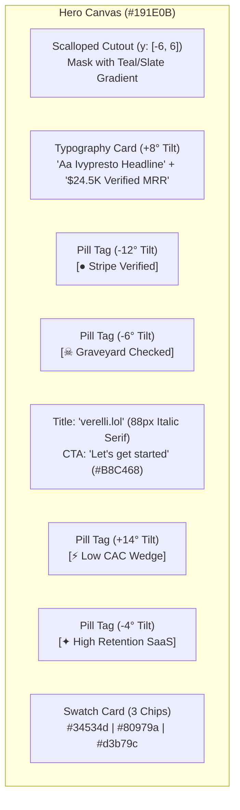

# Design System & Visual Specification — verelli.lol
### 1:1 Architectural Implementation of the Google Labs Pomelli Aesthetic

---

## 1. Visual Philosophy & Design Language

The design system for **verelli.lol** is a direct 1:1 translation of the sophisticated visual language established by Google Labs' **Pomelli** experiment. 

It diverges intentionally from cookie-cutter SaaS aesthetics (generic purple/blue gradients, flat white dashboards, and standard system sans-serifs). Instead, verelli.lol blends:
- **Botanical Luxury & Deep Earth Tones:** Deep olive-black canvases inspired by aged dark foliage, moss, and volcanic stone.
- **High-Contrast Editorial Typography:** Romantic, high-contrast italic serif headlines paired with precise, structural Swiss sans-serif typography.
- **Tactile Floating Objects:** Scalloped organic cutouts, tilted card tags (`-12°` to `+15°`), and micro-surfaces that react to cursor parallax.
- **Luminescent Ambient Lighting:** Soft, ethereal radial olive glows (`rgba(163, 184, 99, 0.22)`) that simulate physical light radiating behind glass cards.

---

## 2. Complete Color Tokens & Surface Palette

### 2.1 Surface & Background Tokens

| Token Name | Hex Code | Role & Usage |
| :--- | :--- | :--- |
| `canvas-hero` | `#191E0B` | Deep botanical olive base canvas for the landing hero screen. |
| `canvas-app` | `#11120E` | Ultra-dark obsidian olive base canvas for onboarding, modals, and verdict workspace. |
| `surface-card-base` | `#181916` | Primary matte charcoal olive for 4-step onboarding cards and verdict bento tiles. |
| `surface-card-raised`| `#242620` | Elevated charcoal olive for floating hero cards, compliance modal, and preview containers. |
| `surface-input-card` | `#23251F` | Focused startup idea input card surface. |
| `surface-input-field`| `#161713` | Recessed dark input text field fill. |
| `surface-backdrop` | `#121210` | Ultra-dark semi-translucent modal backdrop (`80% opacity + backdrop-blur`). |

### 2.2 Border Tokens

| Token Name | Hex Code | Spec & Usage |
| :--- | :--- | :--- |
| `border-subtle` | `#2E3029` | `1px solid #2E3029` — Standard default border on onboarding cards and bento items. |
| `border-modal` | `#3A3D34` | `1px solid #3A3D34` — Compliance modal and floating hero card perimeter. |
| `border-focused` | `#44473E` | `1px solid #44473E` — Focused startup idea input card highlight border. |
| `border-moss` | `#363E1D` | `1px solid #363E1D` — Pill button border and subtle active indicators. |
| `border-ring-lime` | `#B8C468` | Focus ring glow on input field focus. |

### 2.3 Interactive Pill Button Tokens

| Token Name | Background | Text Color | Border | Hover State | Usage |
| :--- | :--- | :--- | :--- | :--- | :--- |
| `btn-primary-lime` | `#B8C468` | `#14180A` | None | Background: `#C6D276`, Box-Shadow: `0 0 20px rgba(184, 196, 104, 0.35)` | Hero CTA `"Let's get started"`, `"Let's go!"` |
| `btn-secondary-moss`| `#363E1D` | `#C5D37A` | `1px solid #4F5A2C` | Background: `#454F26` | `"No website yet? Type raw idea"`, `"Agree & continue"` |
| `btn-secondary-grey`| `#373835` | `#9E9F9A` | `1px solid #52544E` | Background: `#4A4C47`, Text: `#E3E5DC` | `"Continue"` action button |
| `btn-text-ghost` | `transparent`| `#9A9D93` | None | Text: `#EDEFE6` | `"Exit"`, `"Skip for now"` |

### 2.4 Editorial & Risk Swatch Palette

| Swatch Token | Hex Code | Visual Identity |
| :--- | :--- | :--- |
| `swatch-teal` | `#34534d` | Deep Forest Teal (Low CAC / Favorable Market Indicator) |
| `swatch-slate` | `#80979a` | Sage Slate (Medium Risk / Contested Category) |
| `swatch-ochre` | `#d3b79c` | Warm Sand Ochre (High Capital Intensity / Warning) |
| `risk-graveyard` | `#F87171` | Crimson Soft Red (Post-Mortem Fatal Flaw Tag) |
| `metric-mrr` | `#4ADE80` | Emerald Soft Green (Stripe-Verified Live MRR Tag) |

### 2.5 Ambient Glow Gradients

```css
/* Signature Pomelli Olive-Sage Radial Glow */
--glow-olive-ambient: radial-gradient(
  circle at center,
  rgba(163, 184, 99, 0.22) 0%,
  rgba(17, 18, 14, 0.0) 70%
);

/* Intense Hero Center Aura */
--glow-hero-core: radial-gradient(
  ellipse at 50% 30%,
  rgba(184, 196, 104, 0.14) 0%,
  rgba(25, 30, 11, 0.0) 65%
);
```

---

## 3. Typography & Hierarchy

### 3.1 Font Family Stacks

```css
/* Editorial Display / Headings */
font-family-display: "IvyPresto Headline", "Instrument Serif", "Playfair Display", Georgia, serif;

/* UI, Meta, Numbers, & Body Copy */
font-family-body: "Google Sans", "Plus Jakarta Sans", -apple-system, BlinkMacSystemFont, "Segoe UI", sans-serif;
```

### 3.2 Type Scale & Styling Rules

| Element | Font Family | Size | Weight & Style | Line Height | Color |
| :--- | :--- | :--- | :--- | :--- | :--- |
| **Hero Display Title** | `Instrument Serif` | `88px` (`5.5rem`) | `400 Italic` | `0.95` | `#EDEFE6` |
| **Section Display Title** | `Instrument Serif` | `48px` (`3rem`) | `400 Italic` | `1.05` | `#EDEFE6` |
| **Input Card Heading** | `Instrument Serif` | `36px` (`2.25rem`)| `400 Italic` | `1.15` | `#EDEFE6` |
| **Hero Tagline / Subtitle**| `Plus Jakarta Sans`| `18px` (`1.125rem`)| `400 Regular` | `1.5` | `#9A9D93` |
| **Card Step Numbers** | `Plus Jakarta Sans`| `28px` (`1.75rem`) | `700 Bold` | `1.0` | `#80979a` |
| **Card Titles** | `Plus Jakarta Sans`| `18px` (`1.125rem`)| `600 SemiBold`| `1.3` | `#EDEFE6` |
| **Card Body Copy** | `Plus Jakarta Sans`| `14px` (`0.875rem`)| `400 Regular` | `1.45`| `#9A9D93` |
| **Button Text** | `Plus Jakarta Sans`| `15px` (`0.9375rem`)| `500 Medium` | `1.0` | Inherited |
| **Pill Tags / Badges** | `Plus Jakarta Sans`| `12px` (`0.75rem`) | `500 Medium` | `1.0` | Inherited |

---

## 4. Component Anatomy & Specifications

### 4.1 Floating Hero Elements (Pomelli 1:1)



- **Scalloped Cutout Mask (`ScallopedCutout.tsx`):**
  - SVG mask with 8 organic scalloped cloud bumps.
  - Interior fill: Soft botanical mesh gradient blending `#34534d` and `#80979a`.
  - Motion: Continuous vertical spring hover `y: [-6, 6]` over 4.5 seconds with cubic ease-in-out.
- **Tilted Pill Tags (`TiltedPillTag.tsx`):**
  - Shape: `border-radius: 9999px`.
  - Dimensions: `padding: 8px 16px`.
  - Surface: `#1B200E` or `#242620`, border `1px solid #363E1D`.
  - Rotations: Fixed CSS tilts:
    - `Stripe Verified`: `-12deg`
    - `Graveyard Checked`: `-6deg`
    - `Low CAC`: `+14deg`
    - `High Retention`: `-4deg`
- **Typography & MRR Card (`TypographyCard.tsx`):**
  - Dimensions: `220px` width, `140px` height, border-radius `16px`.
  - Background: `#242620`, border `1px solid #2E3029`.
  - Transform: `rotate(8deg) translate3d(0, 0, 0)`.
  - Content: Editorial sample letterforms and live MRR snippet.

---

### 4.2 Onboarding 4-Step Grid Cards (`StepCard.tsx`)

- **Outer Dimensions:** Width `100%` (flex/grid `min-width: 260px`, `max-width: 320px`), Height `440px`.
- **Corner Radius:** `24px`.
- **Card Surface:** Matte Charcoal `#181916`, border `1px solid #2E3029`.
- **Internal Padding:** `24px`.
- **Layout Architecture:**
  - **Upper Half (Text & Meta):**
    - Step Number: `28px` bold sans-serif in `#80979a` (e.g. `1`, `2`, `3`, `4`).
    - Title: `18px` semibold `#EDEFE6` with margin-top `12px`.
    - Description: `14px` regular `#9A9D93`, 2-line height clamped.
  - **Lower Half (Preview Container):**
    - Inset Box: Rounded container (`border-radius: 16px`, background `#11120E`, border `1px solid #23251F`, height `210px`).
    - Ambient Glow: Centered radial glow (`rgba(163, 184, 99, 0.22)`).
    - Miniature Mockup Components:
      - *Card 1:* Simulated typing search bar with pill cursor.
      - *Card 2:* Red skull badge, year of failure, and post-mortem snippet.
      - *Card 3:* Green MRR badge with live pulse dot and subscriber metrics.
      - *Card 4:* Radial score gauge indicator with actionable checklist pills.

---

### 4.3 Focused Startup Idea Input Card (`IdeaInputCard.tsx`)

- **Card Dimensions:** Max-width `680px`, width `100%`, border-radius `24px`, padding `40px 36px`.
- **Card Surface:** `#23251F`, border `1px solid #44473E`.
- **Underlying Ambient Aura:** Positioned directly over an absolute radial gradient (`width: 720px`, `height: 380px`, background: `radial-gradient(circle, rgba(163, 184, 99, 0.25) 0%, transparent 70%)`).
- **Heading:** Centered italic serif *"Enter your startup idea"*, `36px`, color `#EDEFE6`.
- **Subtitle:** Centered sans-serif *"We'll analyze your concept against 1,700+ dead startups and 12,000+ profitable SaaS businesses"*, `15px`, color `#9A9D93`.
- **Input Area:**
  - Height: `56px` or multi-line `88px`.
  - Surface: `#161713`, border `1px solid #363E1D`, border-radius `14px`.
  - Typography: `16px` sans-serif, text `#EDEFE6`, placeholder `#686B60`.
  - Focus Ring: `1px solid #B8C468` with subtle lime box-shadow.
- **Button Row:**
  - Left Button: Wide pill `"No website yet? Type raw idea"` (`#363E1D`, text `#C5D37A`, padding `12px 24px`).
  - Right Button: Wide pill `"Continue"` (`#373835`, text `#9E9F9A`, padding `12px 28px`).

---

### 4.4 Verdict Bento Workspace (`VerdictBento.tsx`)

Organized as an 8-point responsive CSS grid:
1. **Survival Score Tile (Col Span 4):**
   - Background `#181916`, border `#2E3029`.
   - Circular SVG gauge with animated stroke offset displaying `0–100%`.
   - Classification Pill: e.g. `[✦ High-Potential Wedge]` in `#1B200E` with `#B8C468` border.
2. **Dead Twins Tile (Col Span 8):**
   - Background `#181916`, border `#2E3029`.
   - Header: Skull icon + *"1,700+ Startup Graveyard Post-Mortems"*.
   - 3 nested accordions with red accent badges (`- $4.2M Burned`, `YC S19`, `High CAC Trap`).
3. **Cashflow Twins Tile (Col Span 8):**
   - Background `#181916`, border `#2E3029`.
   - Header: Stripe badge + *"12,000+ Stripe-Verified Profitable Peers"*.
   - 3 nested cards with green live indicators (`$24.5K MRR`, `390 Subscribers`, `Flat Pricing`).
4. **48-Hour Validation Playbook (Col Span 4):**
   - Background `#181916`, border `#2E3029`.
   - Step-by-step checklist cards for Hour 0–12, Hour 12–24, and Hour 24–48.
   - Primary Action: `"Export Validation Book"`.

---

## 5. Motion, Physics & Micro-Interactions

### 5.1 Spring Animation Profiles (Framer Motion)

```typescript
// Gentle Hero Float Physics
export const heroFloatTransition = {
  y: {
    duration: 4.5,
    repeat: Infinity,
    repeatType: "reverse",
    ease: "easeInOut",
  },
};

// Modal & Card Spring Entrance
export const modalSpring = {
  type: "spring",
  stiffness: 340,
  damping: 26,
  mass: 0.9,
};

// Interactive Hover Spring for Buttons & Tags
export const buttonHoverSpring = {
  scale: 1.03,
  transition: {
    type: "spring",
    stiffness: 400,
    damping: 15,
  },
};
```

### 5.2 Parallax Cursor Protocol
Floating cards on Screen 1 track the user's cursor dynamically:
- Max tilt variance: `± 4 degrees`.
- Max translation variance: `± 12 pixels`.
- Interpolated using Framer Motion's `useMotionValue` and `useSpring` to eliminate frame judder.

