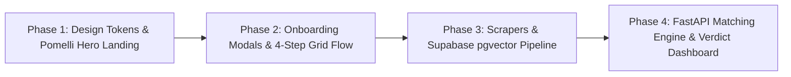

# Step-by-Step Implementation Roadmap — verelli.lol

---

## Strategic Overview

The development of **verelli.lol** is divided into four sequential, milestone-driven phases. Each phase is self-contained and requires full verification before proceeding to the next.

---

## Phase 1: Design Tokens & Pomelli Hero Landing Canvas

**Objective:** Establish the design infrastructure and build the 1:1 Pomelli hero landing screen with floating organic cutouts, tilted pills, and the experiment video container.

### Step-by-Step Deliverables:
1. **Repository & Next.js Monorepo Setup:**
   - Scaffold Next.js 15 App Router in `apps/web` with TypeScript.
   - Configure Tailwind CSS with the exact design tokens from `design.md`.
   - Import and configure Google Font alternatives (`Instrument Serif` in 400 Italic, `Plus Jakarta Sans` in 400/500).
2. **Hero Typography & Centerpiece (`HeroCanvas.tsx`):**
   - Render the italic serif display title *"verelli.lol"* (`88px`, letter spacing `-0.02em`).
   - Editorial subtitle: *"Validate your startup idea with graveyard post-mortems and verified MRR"*.
   - Primary Pistachio-Lime pill CTA: `"Let's get started"` (`#B8C468`) with dark botanical olive text (`#14180A`).
3. **Framer Motion Floating Ambient Elements:**
   - `ScallopedCutout.tsx`: Organic botanical SVG mask with floating animation (`y: [-6, 6]`, duration `4s`).
   - `TypographyCard.tsx`: Tilted matte card (`+8°`) showing `Aa Ivypresto Headline` and `$24.5K Verified MRR`.
   - `SwatchPaletteCard.tsx`: 3-chip vertical swatch displaying `#34534d`, `#80979a`, `#d3b79c`.
   - `TiltedPillTag.tsx`: Reusable floating pills tilted at `-12°`, `-6°`, `+14°`, and `-4°` with text (`Stripe Verified`, `Graveyard Checked`, `Low CAC`, `High Retention`).
4. **Embedded Experiment Video Frame & Footer:**
   - Ambient glowing container with label `"Introducing verelli.lol | Product Experiment"`.
   - Responsive 16:9 video player placeholder with soft olive inner glow (`rgba(163, 184, 99, 0.22)`).
   - Minimalist footer with Google Labs-style attribution.

### Phase 1 Verification Checklist:
- [ ] Next.js dev server boots cleanly with zero hydration warnings.
- [ ] Botanical olive background (`#191E0B`) renders without white flash.
- [ ] Title *"verelli.lol"* renders in authentic italic serif typography.
- [ ] Floating elements animate smoothly at 60fps with spring physics.
- [ ] Clicking `"Let's get started"` updates the URL to `/?step=terms`.

---

## Phase 2: Onboarding Modals & 4-Step Grid Flow

**Objective:** Build the interactive onboarding journey including compliance, updates opt-in, 4-step overview grid, and the focused idea input card.

### Step-by-Step Deliverables:
1. **Query-Parameter State Orchestrator (`useStepNavigation.ts`):**
   - Manage modal step states (`?step=terms`, `?step=welcome`, `?step=input`) cleanly through Next.js `useSearchParams` and shallow router transitions.
2. **Screen 2: "Things to Know" Compliance Modal (`ThingsToKnowModal.tsx`):**
   - Semi-translucent obsidian overlay (`#121210 / 80%`).
   - Centered matte charcoal card (`#252622`) with 24px border-radius and `1px solid #3A3D34`.
   - Ingested source transparency (`Startups.RIP` and `TrustMRR`) with olive-underlined interactive links.
   - Action buttons: `"Exit"` (returns to hero) and `"Agree & continue"` (`#1B200E` pill).
3. **Screen 3A: "Stay Connected" Modal (`StayConnectedModal.tsx`):**
   - Optional pre-grid popup with lime-styled custom checkboxes (`Weekly Graveyard Deconstructs`, `Verified Revenue Alerts`).
   - Pistachio-lime `"Confirm"` button and `"Skip for now"` link.
4. **Screen 3B: "Welcome to verelli.lol" 4-Step Onboarding Grid (`OnboardingGrid.tsx`):**
   - Header with lime flask badge, italic serif heading *"Welcome to verelli.lol"*, and subtitle.
   - 4-column responsive horizontal card grid:
     - Card 1: *Build your Idea Profile* (mini input preview with typing simulation).
     - Card 2: *Scan the Startup Graveyard* (mini post-mortem card with skull tag and burned capital).
     - Card 3: *Verify Live Niche MRR* (mini Stripe MRR badge with subscriber count).
     - Card 4: *Create your Validation Book & 48h Plan* (mini gauge and checklist preview).
   - Inset preview boxes with radial glow (`rgba(163, 184, 99, 0.22)`).
   - Bottom center pistachio-lime pill button `"Let's go!"` navigating to `?step=input`.
5. **Screen 4: Focused Idea Input Card (`IdeaInputCard.tsx`):**
   - Centered rounded card (`#23251F`, `1px border #44473E`) over ambient radial glow.
   - Italic serif heading *"Enter your startup idea"*.
   - Full-width dark input field with subtle focus ring.
   - Dual bottom pill buttons: Left `"No website yet? Type raw idea"` (`#363E1D`), Right `"Continue"` (`#373835`).

### Phase 2 Verification Checklist:
- [ ] Modal transitions animate smoothly with Framer Motion backdrop blur.
- [ ] Browser Back and Forward buttons correctly toggle modals via query parameters.
- [ ] 4-card grid is horizontally scrollable or wraps gracefully on mobile.
- [ ] Input card accepts raw text or URLs and triggers form submission state.

---

## Phase 3: Data Scrapers & Supabase `pgvector` Pipeline

**Objective:** Ingest and index 1,700+ YC graveyard records from `Startups.RIP` and 12,000+ Stripe-verified records from `TrustMRR` with OpenAI embeddings in Supabase.

### Step-by-Step Deliverables:
1. **Database Schema & Vector Migrations:**
   - Apply SQL migration creating `startups_graveyard`, `profitable_startups`, and `validation_reports` tables.
   - Create HNSW cosine vector indexes (`m=16`, `ef_construction=64`).
   - Deploy `match_graveyard_startups` and `match_profitable_startups` PostgreSQL RPC functions.
2. **`Startups.RIP` Scraper Worker (`apps/api/app/scrapers/startups_rip.py`):**
   - Scrape company name, YC batch, funding amount, founded/died years, failure taxonomy, and full post-mortem text.
   - Clean, normalize, and parse failure tags (`high_cac`, `premature_scaling`, `zero_retention`).
3. **`TrustMRR` Ingestion Worker (`apps/api/app/scrapers/trustmrr.py`):**
   - Ingest verified startup listings, live Stripe MRR, active subscriber counts, ARPU, pricing models, and primary acquisition channels.
4. **Batch Vector Embedding Pipeline (`apps/api/app/services/embedding_service.py`):**
   - Batch vectorize company summaries using `text-embedding-3-small` (1536 dimensions).
   - Upsert vectors into Supabase in chunks of 100 with exponential backoff retry.

### Phase 3 Verification Checklist:
- [ ] Supabase tables populated with verified records.
- [ ] Vectors present for 100% of ingested rows.
- [ ] RPC similarity search queries complete in <20ms for sample test queries.

---

## Phase 4: FastAPI Matching Engine & Verdict Dashboard

**Objective:** Connect the frontend to FastAPI, execute parallel dual-vector searches, synthesize insights using LLM structured output, and render the Pomelli Verdict Bento Workspace.

### Step-by-Step Deliverables:
1. **FastAPI Validation Endpoint (`/api/v1/validate`):**
   - Accept user idea string or URL.
   - Embed user idea into 1536d vector via OpenAI embedding service.
   - Execute parallel RPC queries for top 3 dead twins and top 3 cashflow twins.
   - Enforce the `0.65` cosine similarity boundary with automatic *Uncharted Niche* fallback.
2. **LLM Synthesis Engine (`synthesis_service.py`):**
   - Pass prompt with matched records to Gemini 1.5 Pro / GPT-4o with strict Pydantic JSON schema.
   - Output calibrated Survival Score (0–100%), fatal traps, wedge positioning angle, and 48-Hour Validation Playbook.
   - Store report in `validation_reports` table and return report ID.
3. **Screen 5: The verelli.lol Verdict Bento Workspace (`/verdict/[id]`):**
   - 4-card asymmetric Bento layout matching Pomelli aesthetic:
     - Card 1: Animated SVG Survival Gauge (`0-100%`) with risk level badge.
     - Card 2: Top 3 Dead Twins cards with burned capital and highlighted fatal flaw quotes.
     - Card 3: Top 3 Cashflow Twins cards with live Stripe MRR, ARPU, and acquisition channels.
     - Card 4: 48-Hour Validation Playbook with actionable hourly sprints and export button.
4. **Export & Sharing Capabilities:**
   - Instant copyable share link (`verelli.lol/verdict/:id`).
   - Single-click "Export Validation Book" as Markdown or styled printable PDF.

### Phase 4 Verification Checklist:
- [ ] Full end-to-end flow executes from Hero -> Input -> Vector Search -> Bento Dashboard in < 5 seconds.
- [ ] No hallucinated revenue numbers: all stats trace back to database records.
- [ ] Uncharted niche queries gracefully display adjacent market warnings.
- [ ] Exported Validation Book matches editorial tone and data fidelity.

